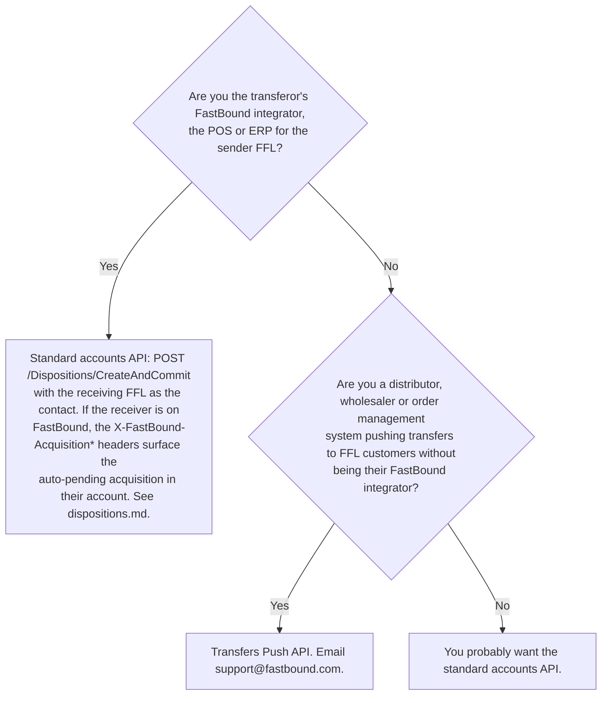

# Partner API

The Partner API is a small, separate API surface aimed at integrators that operate outside the standard FastBound account model. It has two endpoints, each addressing a distinct integrator scenario:

- **`POST /api/accounts`** — provision a new FastBound account (and its owner user) on behalf of an FFL customer. For partners that resell or bundle FastBound (e.g., a POS vendor that creates a FastBound account as part of customer onboarding).
- **`POST /api/transfers`** — the **Transfers Push API**. For external systems (POS, e-commerce, distributors, dealer software) that need to push a transfer to a destination FFL using FastBound, without operating the destination account themselves.

These endpoints are not part of the per-account `/{accountNum}/api/...` surface. They have their own access model, their own request/response conventions, and their own onboarding.

Reference articles and code:
- **Transfers Push API article**: https://fastbound.help/en/articles/10732676-transfers-push-api
- **Validated sample code (multiple languages)**: https://github.com/FastBound/Support/tree/main/samples/transfers — start here when implementing the Transfers Push API. These are FastBound-maintained reference implementations covering common languages and frameworks; treat them as the authoritative shape for request bodies, retry handling, and idempotency-key patterns. If your language has a sample, port from it rather than building from scratch.
- **JSON Schema**: https://schemas.fastbound.org/transfers-push-v1.json — for IDE intellisense and request validation in your CI.
- **OpenAPI for the partner endpoints**: https://cloud.fastbound.com/swagger/index.html?urls.primaryName=v1+Partner#/PartnersTransfersV1
- Partner program enrollment / Account provisioning: https://fastbound.help

## Transfers Push API — the most common reason to be here

> **Read this carefully.** Most third-party developers who think they need the Partner API actually need the standard accounts API. Here's the rule:
>
> **If both the transferor and transferee are FastBound customers, you don't need the Transfers Push API.** Transfers between FastBound customers are handled automatically by the platform — see the auto-pending-acquisition flow in `dispositions.md` (the `X-FastBound-Acquisition*` response headers on a disposition commit).
>
> **The Transfers Push API exists for the case where your system holds inventory data but is *not* itself a FastBound customer recording it as A&D.** A distributor's order management system pushing transfers to dealer FFLs (some of whom use FastBound, some of whom may not) is the canonical example.

### Eligibility and access

- "Available at no cost to integrators building integrations that benefit FastBound customers."
- Intended for software developers building POS / e-commerce / distributor / dealer software.
- **To get credentials, email support@fastbound.com.** (For OAuth app review and approval — accessing accounts owned by other parties — that's a separate conversation with sales@fastbound.com. Different conversations, different teams.)

### Authentication — HTTP Basic, with partner credentials

**Partner endpoints authenticate with HTTP Basic auth, using a username and password FastBound issues to you as a partner.** Not an account API key. Not an OAuth bearer token. Those belong to a specific FastBound account; partner credentials do not, and the two are not interchangeable in either direction.

```
Authorization: Basic <base64(partner_username + ":" + partner_password)>
```

This is the detail that most often stops a first integration, because everything else about the request can be perfectly formed while the credential is the wrong *kind*. Three consequences worth holding on to:

- **Partner credentials are not account-scoped.** That is why partner routes live at `/api/transfers` with no `/{accountNum}` prefix, while everything in the accounts API is account-scoped by its path. One partner credential pushes to many destination FFLs; which account a transfer lands in is decided by `transferee` and `transferee_emails` in the body, never by the credential.
- **An account API Key or OAuth access token will not work here**, and the reverse is also true — partner credentials do not authenticate accounts-API calls. If you already hold FastBound credentials for some other purpose, they are the wrong ones for this.
- **No `X-AuditUser`.** That header identifies a user within an account, and a partner credential is not a user in the destination account. The audit identity on the destination side comes from the transfer itself.

Treat the partner password exactly like any other long-lived credential: secrets manager, never `.env`, never source control. See the storage guidance in `authentication.md`.

### Request

```
POST https://cloud.fastbound.com/api/transfers
Authorization: Basic <base64(partner_username:partner_password)>
Content-Type: application/json
```

```json
{
  "idempotency_key": "po-2026-04812:rev1",
  "transferor": "1-99-XXX-XX-XX-99999",
  "transferee": "1-99-YYY-YY-YY-88888",
  "transferee_emails": ["receiving@example.org"],
  "tracking_number": "1Z9...",
  "po_number": "PO-2026-04812",
  "invoice_number": "INV-9921",
  "acquire_type": "Purchase",
  "note": "Standard wholesale order",
  "items": [
    {
      "manufacturer": "Glock",
      "importer": "",
      "country": "Austria",
      "model": "19 Gen5",
      "caliber": "9mm",
      "type": "Pistol",
      "serial": "ABC123",
      "cost": "475.00",
      "price": "599.99",
      "mpn": "PA195S203",
      "sku": "GLK-19-G5",
      "upc": "764503047022",
      "barrelLength": 4.02,
      "overallLength": 7.36,
      "condition": "New",
      "note": ""
    }
  ]
}
```

**On the Required column:** the machine-readable authority is the published JSON Schema at https://schemas.fastbound.org/transfers-push-v1.json — `required` is `$schema`, `idempotency_key`, `transferor`, `transferee`, `transferee_emails`, `items`, plus `manufacturer`, `model`, `caliber`, `type`, `serial` on every item. The bundled `swagger/partner-swagger.json` is generated from the server's command model and has no `required` array with every property nullable, so a schema-driven client generator makes the whole body optional — but it is not silent: each command-level property's `description` opens with "Required." or "Optional." and agrees with the list above. Read the prose, not the shape. One rule appears only there: item `country` is "only required if the Location's settings say so", so treat it as conditionally required and send it when you have it.

| Field | Required | Notes |
|---|---|---|
| `$schema` | **yes — send it** | Value is pinned by `const` to `https://schemas.fastbound.org/transfers-push-v1.json`. The published JSON Schema lists it first in `required`, FastBound's own example carries it, and every validated sample client sends it. The generated OpenAPI has no `$schema` property and carries `additionalProperties: false`, which reads like it would reject the field. It does not: that flag is an artifact of generating a schema from the C# model, and the server ignores properties it does not recognize rather than failing on them. Sending it is what FastBound's own clients do; omitting it fails validation against the schema FastBound publishes for exactly this purpose. |
| `idempotency_key` | **yes** | Up to 255 case-insensitive characters, **derived deterministically from your own shipment id — never generated fresh per attempt.** This is the most misunderstood field on the endpoint and a wrong one writes phantom firearms into a dealer's bound book. Read ["`idempotency_key` — required, and the field most often gotten wrong"](#idempotency_key--required-and-the-field-most-often-gotten-wrong) below before writing the client. |
| `transferor` | yes | Sender's FFL number. With or without hyphens. |
| `transferee` | yes | Receiver's FFL number. With or without hyphens. |
| `transferee_emails` | yes | At least one email address. **Matching uses both email AND FFL number** — at least one of the listed emails must match a FastBound user on the destination account. |
| `tracking_number`, `po_number`, `invoice_number` | optional | Searchable identifiers carried into the destination acquisition. |
| `acquire_type` | optional | The acquisition type to record on the destination side. |
| `note` | optional | Free-text. |
| `items` | yes | At minimum each item needs `manufacturer`, `model`, `caliber`, `type`, `serial`. Use the snake_case schema below — note the differences from the camelCase accounts API. |

### Response

```json
{
  "accountNumber": 12345,
  "acquisitionId": "guid",
  "acquisitionUrl": "https://cloud.fastbound.com/..."
}
```

The destination FFL receives a **pending** acquisition. They must review and commit it themselves via `POST /Acquisitions/{id}/Commit` — the push API doesn't commit on their behalf; commitment is the receiver's regulatory act.

### Match-failure case

> "If none of the email addresses included in the request match a FastBound account, the response will indicate that no matching accounts could be found."

Practical recommendation from FastBound: when you onboard a customer (a dealer FFL who will receive transfers from you), add a **designated FastBound email field** in your UI that they can update to opt in (or out) of electronic transfers. Pull that email into `transferee_emails` for the push.

### Field-naming inconsistencies, called out

**The casing is mixed inside one body — don't apply a single convention to the whole payload.** Command level is snake_case (`idempotency_key`, `tracking_number`, `po_number`, `invoice_number`, `acquire_type`). Item level is not: `barrelLength` and `overallLength` are camelCase, sitting beside all-lowercase `manufacturer`, `model`, `caliber`, `serial`, `country`. A serializer set to snake_case for the whole request sends `barrel_length` and `overall_length`, and those do not error — the server ignores unrecognized properties, so the lengths are silently dropped and the dealer's record is missing them. Nothing tells you; the transfer succeeds. The item schema also differs from the accounts API: `country` (not `countryOfManufacture`) and `overallLength` (not `totalLength`). Don't share serializers between the two surfaces; treat them as distinct schemas.

**The published JSON Schema is looser than the server on FFL numbers.** Its pattern accepts any digit for the region and any two digits for the licence type; the server accepts only regions `1,3,4,5,6,8,9` and types `01,02,03,06,07,08,09,10,11`. A request can therefore pass your CI validation and still come back 400. Both agree that every hyphen is optional and that the expiration letter is A-M excluding I, case-insensitive — so `1-23-456-01-1A-12345` and `123456011A12345` are equally acceptable, and normalization strips hyphens and uppercases.

The OpenAPI surface for the partner endpoints lives at:
**https://cloud.fastbound.com/swagger/index.html?urls.primaryName=v1+Partner#/PartnersTransfersV1**

### Errors

Partner endpoint errors return RFC 7807 `application/problem+json` documents — different shape from the accounts API's `{ errors: [{ field, message }] }` format. Parse `type`, `title`, `status`, `detail`, `instance`.

### `idempotency_key` — required, and the field most often gotten wrong

**This is the field to get right.** It is required on every transfer, and it is misunderstood more than anything else on this endpoint. Read this section before you write the client, not after your first duplicate.

**What it protects.** A transfer creates a pending acquisition in a dealer's **bound book** — a federal record. A duplicate is not a duplicate row in your database that someone quietly cleans up; it is a phantom firearm in a regulated record that a licensee has to notice, investigate, and delete. Ordinary retry logic — a timeout, a 500, a redeployed worker replaying a queue — is exactly what produces them, and a network timeout is the worst case because you genuinely do not know whether the transfer landed.

**The key is what makes a retry safe.** Send the same key again and FastBound returns the original result instead of creating a second transfer. That property only holds if the key is *identical* across attempts.

#### The two ways to get it wrong

**Too volatile — the common one, and it produces duplicates.** If the key changes between attempts, every retry is a brand-new transfer as far as FastBound is concerned, and the field has bought you nothing. Never build a key from:

- a fresh `uuid4()` generated at call time — a new one per attempt is the single most common mistake
- a retry or attempt counter
- a timestamp, a request id, or anything else that moves

**Too broad — the quiet one, and it drops shipments.** If two genuinely different transfers share a key, the second is treated as a replay of the first and silently does nothing. A dealer's second shipment never arrives in their book and nobody gets an error. A key built from the FFL pair alone, or from a PO number that your system reuses across shipments, does this.

#### Deriving one correctly

The key must be **deterministic** — recomputable from data you already store — and **unique to one shipment**. Derive it, do not generate it:

```
transfer:{your_shipment_id}
```

`{your_shipment_id}` is whatever your system already calls this one physical shipment. If a shipment can legitimately be re-sent as a corrected version, include the revision — but the revision of the *shipment*, never of the attempt:

```
transfer:SHIP-88231          — first send, and every retry of it
transfer:SHIP-88231:rev2     — a corrected re-send, deliberately a new transfer
```

Up to 255 characters, compared case-insensitively.

**Persist the key with the order before you call.** A retry that happens after a process restart has to reproduce the same key from durable state. A key that exists only in the memory of the process that crashed is not idempotent.

**Test it.** Send the same transfer twice with the same key and confirm you get one pending acquisition, not two. It is a two-minute check that catches every mistake above, and it is the check nobody runs before going live.

#### The content-hash approach, and the trap inside it

FastBound's own samples take a second valid approach: hash the payload itself — the FFL pair, the tracking/PO/invoice numbers, and the item serials — into a SHA-256 digest. That is a sound pattern and much better than a per-attempt UUID, because the same shipment reproduces the same key with no extra state to persist.

**If you copy it, check every component of the digest is a fact about the shipment — never a clock read.** A date component is the one to look at. `new Date()`, `time.Now()`, `datetime.utcnow()` and friends read the clock at call time, so they are stable *within* a day and change across a UTC midnight. Most of the time that is invisible. It bites at the boundary: a call at 23:59:50 UTC that times out and is retried at 00:00:05 hashes a different date, produces a different key, and writes a **duplicate pending acquisition** into the dealer's book. A dead-letter replay or a manual re-run the next morning does the same.

Hash the shipment's own date if you want a date in there at all — the date your system recorded the shipment, which is a fact about the shipment and identical on every retry:

```ts
// Wrong: a clock read. Changes across a UTC midnight, so a retry duplicates.
new Date().toISOString().split("T")[0]

// Right: a stable fact about this shipment, identical on every attempt.
shipment.shippedOn   // e.g. "2026-09-02", from your own record
```

Every other component of that digest is already stable. The clock read is the only part that moves, and it is the only part that can hurt you.

### Implementation: start from the FastBound samples

For the Transfers Push API specifically, FastBound maintains validated sample code at **https://github.com/FastBound/Support/tree/main/samples/transfers** — multiple languages, real working request bodies, and dependency-free clients. **Default to porting from these samples rather than writing your client from scratch.** They reflect the current schema and the patterns FastBound has seen work in production. If your language isn't covered, pick the closest sample as your reference shape.

They are the right starting point for `idempotency_key` in particular: they derive it as a SHA-256 content hash rather than generating a fresh value per attempt, which is the pattern you want. Port that shape — and when you do, satisfy yourself that every component of the digest is a fact about the shipment rather than a clock read. See ["The content-hash approach, and the trap inside it"](#the-content-hash-approach-and-the-trap-inside-it) above for why the date component is the one to check.

### Decision tree: do I want the Transfers Push API?



## Account provisioning — `POST /api/accounts`

For partners who resell or bundle FastBound — e.g., a POS vendor that creates a FastBound account as part of customer onboarding — this endpoint creates an account and its owner user atomically.

```json
POST /api/accounts
Content-Type: application/json

{
  "verifiedEmailAddress": "owner@example.com",
  "fflNumber": "1-99-XXX-XX-XX-99999",
  "accountNickname": "Springfield Main Store",
  "planId": "...",
  "timeZoneId": "America/Chicago"
}
```

| Field | Required | Notes |
|---|---|---|
| `verifiedEmailAddress` | yes | Email of the account owner user. **Must already be verified on the partner side**; FastBound trusts the partner that the email is real. |
| `fflNumber` | yes | The FFL number of the account to create. |
| `accountNickname` | no | Defaults to the FFL's trade name (or license name) if null. |
| `planId` | yes | Billing plan ID — partners receive valid plan IDs from FastBound. |
| `timeZoneId` | yes | IANA time zone (e.g., `America/Chicago`, `America/Los_Angeles`). Used for business-day calculations and disposition timing. |

Response:

```json
{
  "id": "guid",
  "number": 12345,
  "apiKey": "..."
}
```

> **The `apiKey` field returned here is the legacy Basic Auth API Key for the new account.** That mechanism is being phased out in favor of OAuth (see `authentication.md`), but the provisioning response is currently structured around it. Treat `apiKey` as a long-lived bearer credential and store it accordingly (secrets manager, never `.env`, never source control). Expect this surface to evolve as the OAuth-only direction firms up; check the help site for current state.

Errors return `application/problem+json` (RFC 7807) — different shape from the accounts API.

## When *not* to use the Partner API

If you're doing any of these, you want the **accounts API**, not the Partner API:

- Building a POS or e-commerce app for FFLs (each customer has their own account; users authenticate via OAuth).
- Building a single-FFL custom integration (your own FFL or a single customer).
- Recording acquisitions and dispositions within an account you own or have OAuth access to.
- Pushing transfers between two FFLs both of whom are on FastBound (the platform handles it automatically — see `dispositions.md`).

## Common pitfalls

- **Reaching for the Transfers Push API when both sides are on FastBound.** Use the standard accounts API and let the platform handle the inter-FFL transfer automatically.
- **Authenticating with the wrong kind of credential** — the most common way a first integration stalls. Partner endpoints take HTTP Basic auth with the partner username and password FastBound issued you. An account API Key or an OAuth bearer token will not work, however valid it is elsewhere; partner credentials are not account-specific, and the two sets are not interchangeable in either direction.
- **Treating Partner endpoints like the accounts API** — different schema (snake_case vs camelCase, `country`/`overallLength`), different error shape (problem+json), different access control (partner program).
- **Generating `idempotency_key` fresh on every attempt** — the most common failure on this endpoint, and it silently defeats the whole mechanism. A `uuid4()` at call time, a retry counter, or a timestamp all make each retry a new transfer, which writes duplicate pending acquisitions into a dealer's bound book. Derive the key from your own shipment id so every attempt reproduces it, and persist it before you call.
- **Reusing one `idempotency_key` across genuinely different shipments** — the opposite mistake, and quieter. The second shipment is treated as a replay, silently does nothing, and never reaches the dealer's book. Keys built from the FFL pair, or from a PO number your system reuses, do this.
- **Wrong `transferee_emails`** — none of the emails matches a user on the destination account → transfer can't resolve the destination → request fails. Build a "designated FastBound email" field in your UI so customers can keep this current.
- **Provisioning an account with an unverified email** — the partner asserts the email has been verified on its side; passing through unverified addresses creates orphaned, unrecoverable accounts.
- **Treating the returned `apiKey` as user-displayable** — it's a credential. Surface it through a secure provisioning flow (one-time password reset link, secure portal), not via email or a CSV export.
- **Asking sales@fastbound.com for Transfers Push credentials** — that's a support@ conversation. Sales handles the OAuth app review for accessing third-party accounts; support handles Partner API onboarding. Email the right inbox.
